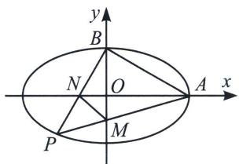
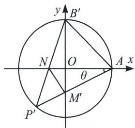

例①（2016·北京）已知椭圆 $C: \frac{x^2}{a^2} + \frac{y^2}{b^2} = 1$ 过点 $A(2,0), B(0,1)$ 两点.

(1)求椭圆 C 的方程及离心率;

(2)设 $P$ 为第三象限内一点且在椭圆 $C$ 上, 直线 $PA$ 与 $y$ 轴交于点 $M$ , 直线 $PB$ 与 $x$ 轴交于点 $N$ , 求证: 四边形ABNM的面积为定值.

