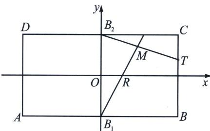

例10 (2024·昆明模拟)如图, 矩形 $ABCD$ 中, $|AB|=4$ , $|BC|=2$ , $A_1$ 、 $B_1$ 、 $A_2$ 、 $B_2$ 分别是矩形四条边的中点, 设 $\overrightarrow{OR}=\lambda\overrightarrow{OA_2}$ , $\overrightarrow{A_2T}=(1-\lambda)\overrightarrow{A_2C}(0<\lambda<1)$ , 设直线 $B_1R$ 与 $B_2T$ 的交点 $M$ 在曲线 $E$ 上.

(1)求曲线 E 的方程;

(2) 直线 l 与曲线 E 交于 Q, N 两点，点 Q 在第一象限，点 N 在第四象限，且满足直线 OQ 与直线 ON 的斜率之积为 $-\frac{1}{4}$ ，若点 P 为曲线 E 的左顶点，且满足 $\overrightarrow{OP} = \lambda \overrightarrow{OQ} + \mu \overrightarrow{ON} (\lambda < 0, \mu < 0)$ ，直线 PQ 与 ON 交于 F，直线 PN 与 OQ 交于 G.

①证明： $\lambda^{2}+\mu^{2}$ 为定值；

②是否存在常数 $m$ ，使得四边形 $QNGF$ 的面积是 $\triangle QON$ 面积的 $m$ 倍？若存在求出 $m$ ，若不存在说明理由.

