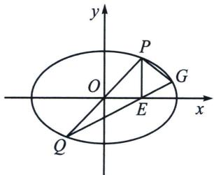
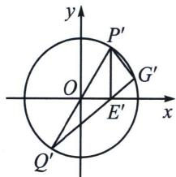

例13 (2019·新课标Ⅱ)已知点A(-2,0)，B(2,0)，动点M(x,y)满足直线AM与BM的斜率之积

为 $-\frac{1}{2}$ . 记M的轨迹为曲线C.

(1)求 C 的方程，并说明 C 是什么曲线；

(2)过坐标原点的直线交 C 于 P，Q 两点，点 P 在第一象限， $PE \perp x$ 轴，垂足为 E，连结 QE 并延长交 C 于点 G.

(i)证明： $\triangle PQG$ 是直角三角形；

(ii) 求 $\triangle PQG$ 面积的最大值.

