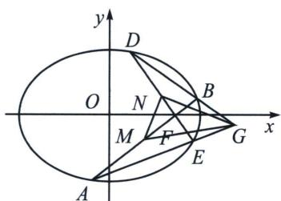
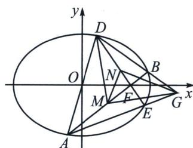

例7 (2024·九省联考 T18)已知椭圆 C: $\frac{x^{2}}{a^{2}} + \frac{y^{2}}{b^{2}} = 1 (a > b > 0)$ ，过右焦点 F 的直线 l 交 C 于 A, B 两点，过点 F 与 l 垂直的直线交 C 于 D, E 两点，其中 B, D 在 x 轴上方，M, N 分别为 AB, DE 的中点。当 $l \perp x$ 轴时， $|AB| = \sqrt{2}$ ，椭圆 C 的离心率为 $\frac{\sqrt{2}}{2}$ 。

(1)求椭圆 C 的标准方程;

(2)证明：直线 $MN$ 过定点，并求定点坐标；

(3)设 G 为直线 AE 与直线 BD 的交点，求 $\triangle GMN$ 面积的最小值.

