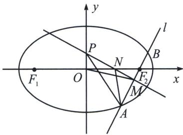

例9 (2024·重庆期末)已知椭圆 $C: \frac{x^2}{a^2} + \frac{y^2}{b^2} = 1 (a > b > 0)$ 的左右焦点为 $F_1$ 、 $F_2$ ，且 $|F_1 F_2| = 4$ ，直线 $l$ 过 $F_2$ 且与椭圆 $C$ 相交于 $A$ 、 $B$ 两点，当 $F_2$ 是线段 $AB$ 的中点时， $|AB| = \frac{2 \sqrt{6}}{3}$ .

(1)求椭圆 C 的标准方程;

(2)当线段 $AB$ 的中点 $M$ 不在 $x$ 轴上时, 设线段 $AB$ 的中垂线与 $x$ 轴交于点 $N$ , 与 $y$ 轴交于点 $P$ , $O$ 为椭圆的中心, 记 $\triangle OMN$ 的面积为 $S_{1}$ , $\triangle APM$ 的面积为 $S_{2}$ , 当 $\frac{S_{1}}{S_{2}}$ 取得最大值时, 求直线 $l$ 的方程.

