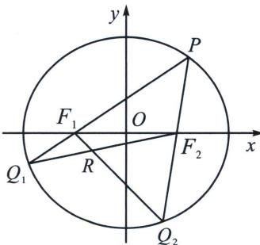

例12 (2025·成都外国语)已知椭圆 $\Gamma: \frac{x^2}{4} + \frac{y^2}{3} = 1$ 的左、右焦点分别为 $F_1$ 、 $F_2$ ，设 $P$ 是第一象限内椭圆 $\Gamma$ 上一点， $PF_1$ 、 $PF_2$ 的延长线分别交椭圆 $\Gamma$ 于点 $Q_1$ 、 $Q_2$ ，直线 $Q_1F_2$ 与 $Q_2F_1$ 交于点 $R$ .

(1)当 $PF_{2}$ 垂直于 x 轴时，求直线 $Q_{1}Q_{2}$ 的方程；

(2)记 $\triangle F_{1}Q_{1}R$ 与 $\triangle F_{2}Q_{2}R$ 的面积分别为 $S_{1}$ 、 $S_{2}$ ，求 $S_{2}-S_{1}$ 的最大值.

