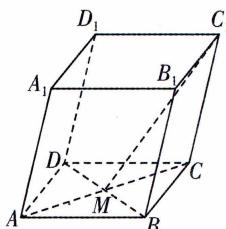

7.[福建厦门2025高二月考]如图,在平行六面体ABCD- $A_{1}B_{1}C_{1}D_{1}$ 中,AC与BD的交点为点 $M$ , $\overrightarrow{AB} = a$ , $\overrightarrow{AD} = b$ , $\overrightarrow{AA_1} = c$ ,则下列向量中与 $\overrightarrow{C_1M}$

相等的向量是 （ ）A. $-\frac{1}{2} a + \frac{1}{2} b + c$ B. $\frac{1}{2} a + \frac{1}{2} b + c$ C. $-\frac{1}{2} a - \frac{1}{2} b - c$ D. $-\frac{1}{2} a - \frac{1}{2} b + c$

