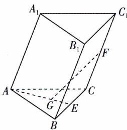

8.[河南南阳一中2024高二月考]如图,在三棱柱 $ABC-A_{1}B_{1}C_{1}$ 中,E,F分别是BC, $CC_{1}$ 的中点,G为△ABC的重心,则 $\overrightarrow{GF}=$ ( )

A. $-\frac{1}{3}\overrightarrow{AB} +\frac{2}{3}\overrightarrow{AC} +\frac{1}{2}\overrightarrow{AA_{1}}$ B. $\frac{1}{3}\overrightarrow{AB} +\frac{2}{3}\overrightarrow{AC} +\frac{1}{2}\overrightarrow{AA_{1}}$ C. $-\frac{2}{3}\overrightarrow{AB} +\frac{1}{3}\overrightarrow{AC} -\frac{1}{2}\overrightarrow{AA_{1}}$ D. $\frac{1}{3}\overrightarrow{AB} -\frac{2}{3}\overrightarrow{AC} +\frac{1}{2}\overrightarrow{AA_{1}}$

