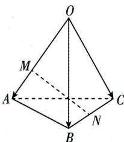

9.[湖南衡阳2025高二期中]如图,在四面体OABC中, $\overrightarrow{OA}=a,\overrightarrow{OB}=b,\overrightarrow{OC}=c$ ,点M在OA上,且满足 $\overrightarrow{OM}=2\overrightarrow{MA}$ ,点N为BC的中点,则 $\overrightarrow{MN}=$ ( )

A. $\frac{1}{2} a - \frac{2}{3} b + \frac{1}{2} c$ B. $-\frac{2}{3} a + \frac{1}{2} b + \frac{1}{2} c$ C. $\frac{1}{2} a + \frac{1}{2} b - \frac{1}{2} c$ D. $\frac{2}{3} a + \frac{2}{3} b - \frac{1}{2} c$

## 相关知识点

暂无已审核的相关知识点。

> 来源：2026版 必刷题 数学选择性必修第一册RJA
