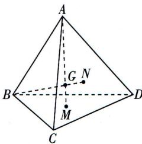

14.[重庆杨家坪中学2024高二月考]如图,已知M,N分别为四面体ABCD的平面BCD与平面ACD的重心,G为AM上一点,且GM:GA=1:3.设 $\overrightarrow{AB}=a,\overrightarrow{AC}=b,\overrightarrow{AD}=c.$ (1)请用a,b,c表示 $\overrightarrow{BN}$ ;
(2)求证:B,G,N三点共线.

