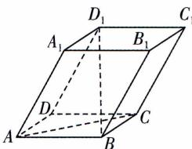

9.[北京东直门中学2025高二段考]如图,在平行六面体 $ABCD-A_{1}B_{1}C_{1}D_{1}$ 中,以顶点A为端点的三条棱的

长度都为 1, 且两两夹角为 $60^{\circ}$ , 则 $\overrightarrow{BD_{1}}$ 与 $\overrightarrow{AC}$ 夹角的余弦值为 ( )
A. $\frac{\sqrt{3}}{3}$ B. $\frac{\sqrt{6}}{6}$ C. $\frac{\sqrt{3}}{4}$ D. $\frac{\sqrt{3}}{6}$

