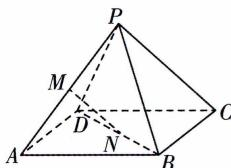

11.[四川眉山2025高二联考]在正四棱锥P-ABCD中，PA=AB,M为PA的中点, $\overrightarrow{BD}=\mu\overrightarrow{BN}(\mu>1)$ .若 $MN\perp AD$ ,则 $\mu=$ ( )
A. 2 B. 3 C. 4 D. 5

## 相关知识点

暂无已审核的相关知识点。

> 来源：2026版 必刷题 数学选择性必修第一册RJA
