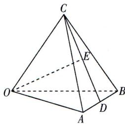

12.[山西太原2024高二期中学业诊断]如图,四面体OABC各棱的棱长都是1,D是AB的中点,E是CD的中点,记 $\overrightarrow{OA}=a,\overrightarrow{OB}=b,\overrightarrow{OC}=c.$ (1)用向量a,b,c表示向量 $\overrightarrow{OE}$ ;
(2)利用向量法证明: $OE \perp AB$ .

## 相关知识点

暂无已审核的相关知识点。

> 来源：2026版 必刷题 数学选择性必修第一册RJA
