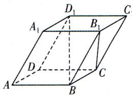

16. 教材变式 [湖北部分省级示范学校 2025 高二期中] 如图, 在平行六面体 $ABCD - A_{1}B_{1}C_{1}D_{1}$ 中, 以顶点 $A$ 为端点的三条棱的长度都为 2 , 且 $\angle BAD = \angle BAA_{1} = \angle DAA_{1} = \frac{\pi}{3}$ .

(1) 求 $BD_{1}$ 的长度;

(2)求直线 $BD_{1}$ 与直线 $CB_{1}$ 所成角的余弦值.

## 相关知识点

暂无已审核的相关知识点。

> 来源：2026版 必刷题 数学选择性必修第一册RJA
