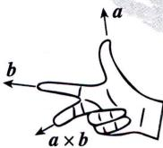

5.(多选)[重庆2025高二月考]在三维空间中,定义向量的外积: $a \times b$ 叫做向量a与b的外积,它是一个向量,满足下列两

个条件:

① $a\perp(a\times b)$ , $b\perp(a\times b)$ ，且 a, b 和 $a\times b$ 构成右手系，即三个向量的方向依次与右手的拇指、食指、中指的指向一致，如图所示；② $a\times b$ 的模 $|a\times b|=|a||b|\sin\langle a,b\rangle$ 。在正方体 ABCD-A₁B₁C₁D₁ 中，有以下四个结论，其中正确的有（）

▶根据向量的运算求夹角 2

A. $|\overrightarrow{AB_1}\times \overrightarrow{AC}| = |\overrightarrow{AD_1}\times \overrightarrow{DB}|$ B. $\overrightarrow{A_1C_1}\times \overrightarrow{A_1D}$ 与 $\overrightarrow{BD_1}$ 共线
C. $\overrightarrow{AB}\times \overrightarrow{AD} = \overrightarrow{AD}\times \overrightarrow{AB}$ D. $6|\overrightarrow{BC}\times \overrightarrow{AC}|$ 与正方体表面积的数值相等

