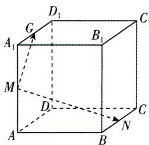

7.[湖北十堰2024高二期中]如图,已知正方体 $ABCD-A_{1}B_{1}C_{1}D_{1}$ 的棱长为4,M,N,G分别是棱 $AA_{1},BC,A_{1}D_{1}$ 的中点,设Q是该正方体表面上的一点,若 $\overrightarrow{MQ}=x\overrightarrow{MG}+y\overrightarrow{MN}(x,y\in\mathbf{R})$ .

(1) 求点 Q 的轨迹围成图形的面积;

(2) 求 $\overrightarrow{MG} \cdot \overrightarrow{MQ}$ 的最大值.

