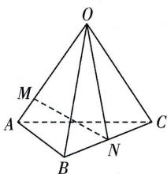

5.[安徽马鞍山二中等校2025高二联考]在四面体OABC中,点M为线段OA上靠近点A的四等分点,N为BC的中点,若 $\overrightarrow{MN}=x\overrightarrow{OA}+y\overrightarrow{OB}+z\overrightarrow{OC}$ ,则 $x+y+z$ 的值为()

A. $\frac{3}{2}$ B. 1 C. $\frac{1}{4}$ D. $\frac{1}{3}$

