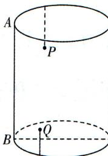

11.[四川成都外国语学校2025高二月考(改编)]现有一段底面周长为 $12\pi$ 厘米和高为15厘米的圆柱形水管,AB是圆柱的母线,两只蚂蚁分别在水管内

壁爬行,一只从点A沿上底部圆弧顺时针方向爬行2π厘米后再向下爬行5厘米到达点P,另一只从点B沿下底部圆弧逆时针方向爬行2π厘米后再向上爬行4厘米到达点Q,则此时线段PQ的长(单位:厘米)为（）
A. $6\sqrt{2}$ B. 12
C. $12\sqrt{2}$ D. $12\sqrt{3}$

## 相关知识点

暂无已审核的相关知识点。

> 来源：2026版 必刷题 数学选择性必修第一册RJA
