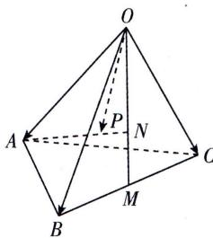

1.[河北唐山二中2025高二月考]如图,在四面体OABC中,M为棱BC的中点,点N,P分别满足 $\overrightarrow{ON}=2\overrightarrow{NM}$ , $\overrightarrow{AP}=3\overrightarrow{PN}$ ,则 $\overrightarrow{OP}=$ ( )

A. $\frac{1}{2}\overrightarrow{OA} +\frac{1}{3}\overrightarrow{OB} +\frac{1}{4}\overrightarrow{OC}$ B. $\frac{1}{2}\overrightarrow{OA} +\frac{1}{4}\overrightarrow{OB} +\frac{1}{4}\overrightarrow{OC}$ C. $\frac{1}{4}\overrightarrow{OA} +\frac{1}{2}\overrightarrow{OB} +\frac{1}{4}\overrightarrow{OC}$ D. $\frac{1}{4}\overrightarrow{OA} +\frac{1}{4}\overrightarrow{OB} +\frac{1}{4}\overrightarrow{OC}$

