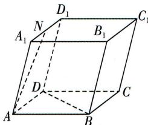

10.[广西多校2025高二联考]在如图所示的平行六面体 $ABCD - A_{1}B_{1}C_{1}D_{1}$ 中，已知 $AB = AA_{1} = AD, \angle BAD = \angle DAA_{1} = 60^{\circ}, \angle BAA_{1} = 30^{\circ}, N$ 为线段 $A_{1}D_{1}$ 上一点，且 $A_{1}N = \lambda A_{1}D_{1}$ . 若 $BD \perp AN$ , 则 $\lambda$ 的值为 \_\_\_\_.

## 相关知识点

暂无已审核的相关知识点。

> 来源：2026版 必刷题 数学选择性必修第一册RJA
