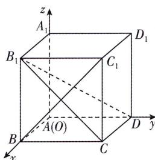

8.[山东部分学校2025高二联考]如图,四棱柱 $ABCD-A_{1}B_{1}C_{1}D_{1}$ 为正方体.

①直线 $CC_{1}$ 的一个方向向量为 $(0,0,1)$ ;
②直线 $BC_{1}$ 的一个方向向量为 $(0,1,1)$ ;
③平面 $B_{1}C_{1}CB$ 的一个法向量为 $(-1,0,0)$ ;
④平面 $B_{1}CD$ 的一个法向量为 $(1,1,1)$ .
则上述结论正确的是\_\_\_\_。(填序号)

