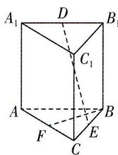
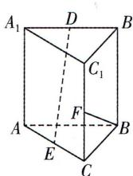
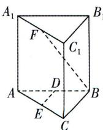

9.[内蒙古部分学校2025高二联考]我国古代数学名著《九章算术》中,将底面为直角三角形,且侧棱垂直于底面的棱柱称为堑堵.已知图①②③都为堑堵, $\angle ABC=\frac{\pi}{2},AB=BC=AA_{1},D,E,F$ 分别是所在棱的中点,则满足 $BF\perp DE$ 的有()

图①
图②

图③

A. 0 个 B. 1 个 C. 2 个 D. 3 个

## 相关知识点

暂无已审核的相关知识点。

> 来源：2026版 必刷题 数学选择性必修第一册RJA
