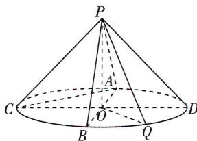

14.[江西南昌一中2024高二月考]如图,圆锥的顶点为P,底面圆心为O,AB,CD为底面圆O内两条互相垂直的直径,Q是底面圆周上的动点(异于A,B),且C,Q在直径AB的两侧.已知PO=OB=1.
(1) 若 $\angle QOB = \frac{\pi}{4}$ ，求证： $PQ \perp AC$ ;
(2) 若在线段 PQ 上存在点 T (异于 P, Q)，使得 BT//平面 PAC，求 $\angle QOB$ 的取值范围.

