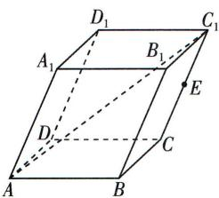

2. 教材变式 [江苏无锡 2025 高二期中] 在棱长为 1 的正方体 $ABCD - A_{1}B_{1}C_{1}D_{1}$ 中, $O$ 为平面 $A_{1}ABB_{1}$ 的中心, $E$ 为 $BC$ 的中点, 则点 $O$ 到直线 $A_{1}E$ 的距离为 ( )
A. $\frac{\sqrt{2}}{6}$ B. $\frac{\sqrt{6}}{6}$ C. $\frac{\sqrt{3}}{6}$ D. $\frac{\sqrt{2}}{3}$

