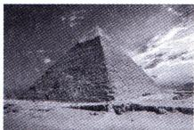
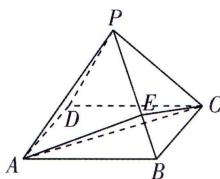

2. 埃及金字塔是世界古代建筑奇迹之一, 它的形状可视为一个正四棱锥. 若正四棱锥 P-ABCD 的高为 $3, AB = 3\sqrt{2}$ , 点 E 满足 $\overrightarrow{PE} = 2\overrightarrow{EB}$ , 则点 D 到平面 AEC 的距离为 ( )

A. $\frac{3\sqrt{5}}{5}$ B. $\frac{4\sqrt{5}}{5}$ C. $\frac{\sqrt{5}}{2}$ D. $\frac{3\sqrt{5}}{2}$
