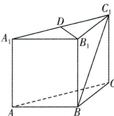

4.[上海浦东2025高二期中]如图,在三棱柱 $ABC-A_{1}B_{1}C_{1}$ 中,侧面 $BCC_{1}B_{1},ABB_{1}A_{1}$ 均为正方形, $AB=BC=1,\angle ABC=90^{\circ}$ ,点D是棱 $A_{1}C_{1}$ 的中点.

(1) 求证: $B_{1} D \perp$ 平面 $A A_{1} C_{1} C$ ;

(2)求异面直线 $B_{1}D$ 与 $BC_{1}$ 所成角的大小.

