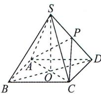

5.[山东济宁2024高二期中]如图,在正四棱锥 $S - ABCD$ 中,O为顶点S在底面内的投影,P为侧棱SD的中

点,且 SO=OC,则直线 CD 与平面 PAC 所成的角是
( )
A. $45^{\circ}$ B. $90^{\circ}$ C. $30^{\circ}$ D. $60^{\circ}$

## 相关知识点

暂无已审核的相关知识点。

> 来源：2026版 必刷题 数学选择性必修第一册RJA
