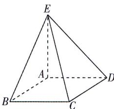

10. [贵州遵义 2025 高二期中] 在棱长为 3 的正方体 $ABCD - A_{1}B_{1}C_{1}D_{1}$ 中, 点 $E, F$ 分别在棱 $AB, CD$ 上, 且满足 $AE = 2EB$ , $CF = 2FD$ , 则二面角 $A_{1} - EF - C_{1}$ 的余弦值为 ( )
A. $\frac{3}{7}$ B. $\frac{4}{7}$ C. $\frac{\sqrt{3}}{7}$ D. $\frac{\sqrt{5}}{7}$

$$
A E \perp
$$

$$
A E =
$$

的夹角为 （ ）A. $45^{\circ}$ B. $60^{\circ}$ C. $120^{\circ}$ D. $150^{\circ}$

