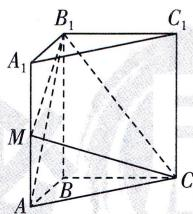

12. (多选) [福建莆田一中 2025 高二月考] 如图, 在直三棱柱 $ABC - A_{1}B_{1}C_{1}$ 中, $CC_{1} = \sqrt{3}$ , $AB = BC = \sqrt{2}$ , $AC = 2$ , 点 $M$ 是

棱 $AA_{1}$ 的中点,则下列说法正确的是( )
A. 异面直线 BC 与 $B_{1}M$ 所成的角为 $90^{\circ}$ B. 在 $B_{1}C$ 上存在点 D, 使 MD//平面 ABC
C. $B_{1}M \perp CM$ D. 二面角 $B_{1}-AC-B$ 的大小为 $60^{\circ}$

