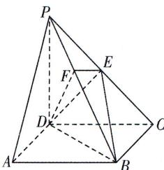

13.[重庆巴蜀中学2025高二期中]如图,在四棱锥P-ABCD中,侧棱PD⊥底面ABCD,DA⊥DC,底面ABCD为平行四边形,DA=DC=DP,E,F分别在棱PC,PB上,PA//平面EDB.
(1) 若 F 是 PB 的中点, 求 EF 与平面 EDB 所成角的余弦值;

(2) 若 $EF \perp PB$ , 求平面 $DEF$ 与平面 $ABCD$ 夹角的余弦值.

## 相关知识点

暂无已审核的相关知识点。

> 来源：2026版 必刷题 数学选择性必修第一册RJA
