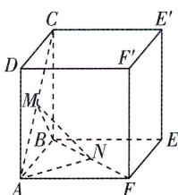

16.[湖北武汉华中师大一附中2024高二月考]如图,在正方体ABEF-DCE'F'中,M,N分别为AC,BF的中点,则平面MNA与平面MNB的夹角的余弦值为
A. $-\frac{1}{3}$ B. $\frac{1}{3}$ C. $-\frac{2\sqrt{2}}{3}$

余弦值为 （ ）
A. $-\frac{1}{3}$ B. $\frac{1}{3}$ C. $-\frac{2\sqrt{2}}{3}$ D. $\frac{2\sqrt{2}}{3}$

立志要如山，行道要如水。不如山，不能坚定，不如水，不能曲达。

