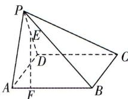

2.[浙江诸暨中学2025高二月考]如图,已知在四棱锥P-ABCD中,底面ABCD是边长为2的正方形, $\triangle PAD$ 是以AD为

斜边的等腰直角三角形, $AB \perp$ 平面 PAD, 点 E 是线段 PD 上的动点(不含端点), 若线段 AB 上存在点 F(不含端点), 使得异面直线 PA 与 EF 所成角为 $30^{\circ}$ , 则线段 PE 长度的取值范围是 ( )
A. $\left(0,\frac{\sqrt{2}}{2}\right)$ B. $\left(0,\frac{\sqrt{6}}{3}\right)$ C. $\left(\frac{\sqrt{2}}{2},\sqrt{2}\right)$ D. $\left(\frac{\sqrt{6}}{3},\sqrt{2}\right)$

