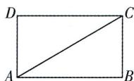
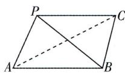

4.[河北保定2024高二月考]已知矩形ABCD中, $AB=\sqrt{3}$ ,AD=1,将 $\triangle ACD$ 沿AC折起到 $\triangle ACP$ 的位置.若 $PB=\sqrt{3}$ ,则二面角P-AC-B的余弦值为()

A. $\frac{2\sqrt{2}}{3}$ B. $\frac{1}{3}$ C. $-\frac{1}{3}$ D. $-\frac{2\sqrt{2}}{3}$ ▶空间角的综合问题 2、6、10

## 相关知识点

暂无已审核的相关知识点。

> 来源：2026版 必刷题 数学选择性必修第一册RJA
