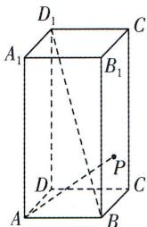

5.[北京海淀区2025高二期中]如图,在四棱柱 $ABCD-A_{1}B_{1}C_{1}D_{1}$ 中,底面ABCD为正方形,侧棱 $AA_{1}\perp$ 底面ABCD,AB=3, $AA_{1}=6,P$ 是侧面 $BCC_{1}B_{1}$ 内的动点,且

$AP \perp BD_{1}$ , 记 $AP$ 与平面 $BCC_{1}B_{1}$ 所成的角为 $\theta$ , 则 $\tan \theta$ 的最大值为 ( )
A. $\sqrt{5}$ B. $\frac{\sqrt{5}}{3}$ C. 2
D. $\frac{25}{9}$

