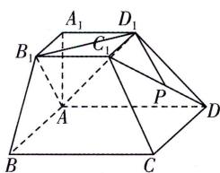

9.[河北沧州部分学校2025高二联考]如图,在四棱台 $ABCD-A_{1}B_{1}C_{1}D_{1}$ 中, $AA_{1}\perp$ 平面 ABCD, 底面 ABCD 为正方形, $AB=2AA_{1}=2A_{1}B_{1}=4$ , 点 P 在线段 $C_{1}D$ 上运动.
(1)证明: $B_{1}D_{1}\perp CC_{1}$ ;
(2)求异面直线 $AB_{1}$ 与 $DD_{1}$ 所成角的余弦值；
(3)求直线 $D_{1}P$ 与平面 $AB_{1}D_{1}$ 所成角的正弦值的取值范围.

