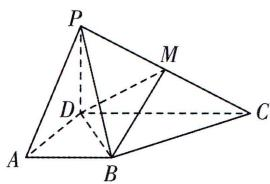

10.[福建三明一中2025高二月考]如图,在四棱锥P-ABCD中,平面PDC⊥平面ABCD, $AD\perp CD,AB//CD,AB=\frac{1}{2}CD=AD=1,M$ 为棱PC的中点.
(1)证明:BM//平面PAD.
(2)若 $PC=\sqrt{5},PD=1$ ,
(i)求二面角P-DM-B的余弦值.
(ii)在线段PA上是否存在点Q,使得点Q到平面BDM的距离是 $\frac{2\sqrt{6}}{9}$ ?若存在,求出PQ的值;若不存在,说明理由.

