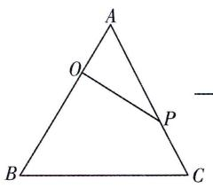
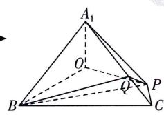

9.[江西上饶2025高二月考]已知等边三角形ABC的边长为3,O,P分别是边AB和AC上的点,且AP=2AO=2,如图①.将△AOP沿OP折起到△A\_{1}OP的位置,连接A\_{1}B,A\_{1}C.点Q满足 $\overrightarrow{A_{1}Q}=2\overrightarrow{QC}$ ,且点Q到平面BCPO的距离为 $\frac{1}{3}$ ,如图②.

(1)求证: $PQ \parallel$ 平面 $A_{1}BO$ ;

(2)求平面 $A_{1}BC$ 与平面 $A_{1}OP$ 夹角的余弦值;

(3)求四面体 $A_{1} - BPQ$ 的体积.

图①

图②

## 相关知识点

暂无已审核的相关知识点。

> 来源：2026版 必刷题 数学选择性必修第一册RJA
