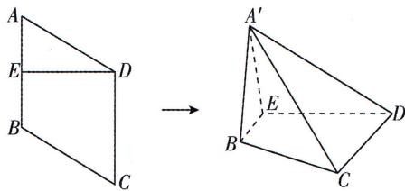

10.[四川成都树德中学2024高二期中]如图,菱形ABCD的边长为4, $\angle BAD=\frac{\pi}{3}$ ,E为AB的中点.将 $\triangle ADE$ 沿DE折起,使点A到达点A'的位置,连接A'B,A'C,得到四棱锥A'-BCDE.
(1)证明: $DE\perp A'B$ ;
(2)当二面角 $A'-DE-B$ 的平面角在 $\left[\frac{\pi}{4},\frac{3\pi}{4}\right]$ 内变化时,求直线 $A'C$ 与平面 $A'DE$ 所成角的正弦值的最大值.

