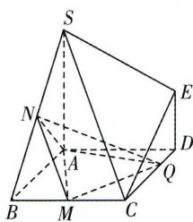

2. (多选) [辽宁大连二十四中 2025 高二期中] 如图, 在多面体 ABCDES 中, $SA \perp$ 平面 ABCD, 四边形 ABCD 是正方形, 且 $DE \parallel SA$ , $SA = AB = 2DE = 2$ ,

M,N分别是线段BC,SB的中点,Q是线段DC上的一个动点(含端点D,C),则下列说法正确的是
( )
A. 存在点Q,使得 $NQ \perp SB$ B. 存在点Q,使得异面直线NQ与SA所成角的余弦值为 $\frac{\sqrt{5}}{5}$ C. 当点Q自D向C处运动时, 直线DC与平面QMN所成的角不变
D. 三棱锥 Q-AMN 体积的最大值是 $\frac{2}{3}$

