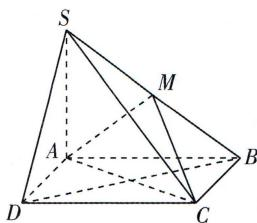

5.[2024THUSSAT中学生标准学术能力诊断性测试]已知四棱锥S-ABCD中,底面ABCD是矩形, $SA\perp BD$ , $SA=AD=\frac{\sqrt{2}}{2}CD$ ,M是SB的中点.
(1)证明: $MC\perp BD$ ;
(2)若 $SA \perp AD, SA = 2$ , 点 P 是棱 SC 上的动点, 直线 AP 与平面 AMC 所成角的正弦值为 $\frac{\sqrt{10}}{10}$ , 求 $\frac{SP}{SC}$ .

