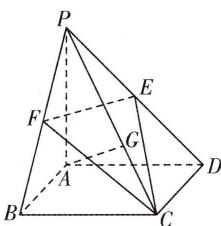

5.[浙江温州2025高二联考]《九章算术》是我国古代数学名著,书中将底面为矩形,且有一条侧棱垂直于底面的四棱锥称为阳马.如图,在阳马

P-ABCD 中, $PA \perp$ 平面 ABCD,底面 ABCD 是矩

建议用时:120 分钟 答案 P123

形，E,F 分别为 PD,PB 的中点，G 为直线 CP 上的动点，PA=2,AB=1，若 $AG \perp$ 平面 EFC，则 $\frac{CG}{CP}=$ () A. $\frac{2}{7}$ B. $\frac{3}{7}$ C. $\frac{4}{7}$ D. $\frac{5}{7}$
