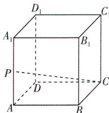
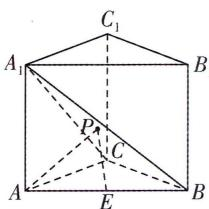

7.[重庆杨家坪中学2024高二月考]如图,已知正方体 $ABCD-A_{1}B_{1}C_{1}D_{1}$ 的棱长为4,P是 $AA_{1}$ 的中点, $\overrightarrow{AM}=\lambda\overrightarrow{AB}+\mu\overrightarrow{AA_{1}},\lambda\in[0,1],\mu\in$

[0,1]. 若 $D_{1}M \perp CP$ ，则 $\triangle BCM$ 面积的最小值为
A.4 B.8 C. $\frac{8\sqrt{5}}{5}$ D. $8\sqrt{2}$

$$
\triangle A B C
$$

$$
A B C - A _ {1} B _ {1} C _ {1}
$$

$$
A B > A C
$$

$ACC_{1}A_{1}$ 为正方形, $\overrightarrow{AB}=2\overrightarrow{AE},P$ 为平面 $A_{1}BC$ 内一动点,则 $PA+PE$ 的最小值是 ( )
A. $\frac{\sqrt{6}}{2}$ B. $\frac{\sqrt{3}}{2}$ C. $\sqrt{5}$ D. $\frac{\sqrt{26}}{5}$

## 二、多项选择题: 本大题共 3 小题, 每小题 6 分, 共 18 分. 在每小题给出的选项中, 有多项符合题目要求. 全部选对的得 6 分, 部分选对的得部分分, 有选错的得 0 分.

## 相关知识点

暂无已审核的相关知识点。

> 来源：2026版 必刷题 数学选择性必修第一册RJA
