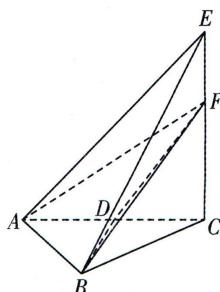

14.[四川多校2025高二联考]如图,在三棱锥 E-ABC 中,平面 ACE⊥平面 ABC, AC = CE = 2AB = 12,∠BAC= $\frac{\pi}{3}$ ,AC⊥CE,D为

AC 的中点, F 是 CE 上的一个动点, 则三棱锥 B-ADF 外接球表面积的最小值为 \_\_\_\_.

## 四、解答题:本大题共5小题,共77分. 解答应写出文字说明、证明过程或演算步骤.

## 相关知识点

暂无已审核的相关知识点。

> 来源：2026版 必刷题 数学选择性必修第一册RJA
