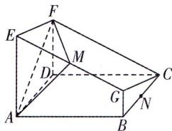

15. (本小题满分 13 分) [山西太原五中 2025 高二月考] 如图, 四边形 $ABCD$ 是正方形, $AE$ , $DF$ , $BG$ 都垂直于平面 $ABCD$ , 且 $AE = 3$ , $DF =$

2, BG=1, M, N 分别是 EG, BC 的中点.

(1) 证明: FM//平面 ABCD.

(2) 若 $AB = 2$ , 求点 $N$ 到平面 $AMF$ 的距离.

## 相关知识点

暂无已审核的相关知识点。

> 来源：2026版 必刷题 数学选择性必修第一册RJA
