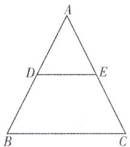
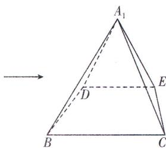

17. (本小题满分 15 分) [广东深圳 2025 高二联考] 如图①, 在 $\triangle ABC$ 中, $D, E$ 分别为 $AB, AC$ 的中点, $AB = AC = 2\sqrt{5}, BC = 4$ . 将 $\triangle ADE$ 沿 $DE$ 折起到 $\triangle A_{1}DE$ 的位置, 使得 $A_{1}C = 2\sqrt{3}$ , 如图②.

(1) 求证: 平面 $A_{1}DE \perp$ 平面 $BCED$ .

(2) 线段 $A_{1}C$ 上是否存在点 $F$ , 使得直线 $DF$ 和 $BC$ 所成角的余弦值为 $\frac{\sqrt{35}}{7}$ ? 若存在, 求出 $\frac{A_{1}F}{A_{1}C}$ 的值; 若不存在, 说明理由.

图①

图②

