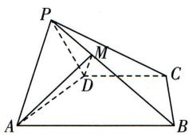

18. (本小题满分 17 分) [河北保定 2025 调研] 如图, 在四棱锥 $P-ABCD$ 中, 底面 $ABCD$ 为梯形, 且满足 $AB \perp BC$ , $AB \parallel CD$ , $AB = 2BC = 2CD = 2\sqrt{2}$ , $PA \perp PD$ , 平面 $PAD \perp$ 平面 $ABCD$ .

(1) 求证: $PA \perp PB$ ;

(2) 若 PA = PD，点 M 在线段 PB 上，当二面角 M - AD - P 的大小为 $\frac{\pi}{4}$ 时，求四棱锥 M - ABCD 的体积.

## 相关知识点

暂无已审核的相关知识点。

> 来源：2026版 必刷题 数学选择性必修第一册RJA
