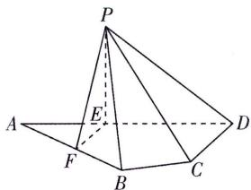

3.[全国新课标Ⅱ2024·17,15分]如图,平面四边形ABCD中,AB=8,CD=3,AD=5 $\sqrt{3}$ , $\angle ADC=90^{\circ}$ , $\angle BAD=30^{\circ}$ , 点E,F满足 $\overrightarrow{AE}=\frac{2}{5}\overrightarrow{AD},\overrightarrow{AF}=\frac{1}{2}\overrightarrow{AB}$ , 将 $\triangle AEF$ 沿EF翻折至 $\triangle PEF$ ,使得 $PC=4\sqrt{3}$ .
(1)证明: $EF\perp PD;$ (2)式面,PCD与面,PRF所成的三面角的工(2) 求面 $PCD$ 与面 $PBF$ 所成的二面角的正弦值.

