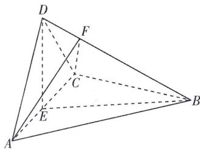

5.[全国乙理2022·18,12分]如图,四面体ABCD中, $AD\perp CD,AD=CD,\angle ADB=\angle BDC,E$ 为AC的中点.
(1)证明:平面 $BED\perp$ 平面ACD;
(2) 设 AB = BD = 2, $\angle ACB = 60^{\circ}$ , 点 F 在 BD 上, 当 $\triangle AFC$ 的面积最小时, 求 CF 与平面 ABD 所成的角的正弦值.

## 相关知识点

暂无已审核的相关知识点。

> 来源：2026版 必刷题 数学选择性必修第一册RJA
