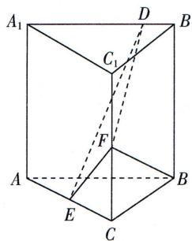
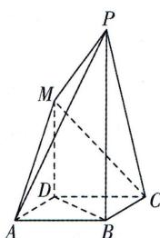

7.[全国甲理2021·19,12分]已知直三棱柱 $ABC-A_{1}B_{1}C_{1}$ 中,侧面 $AA_{1}B_{1}B$ 为正方形,AB=BC=2,E,F分别为AC和 $CC_{1}$ 的中点,D为棱 $A_{1}B_{1}$ 上的点, $BF\perp A_{1}B_{1}$ .
(1)证明: $BF\perp DE.$ (2) 当 $B_{1}D$ 为何值时, 平面 $BB_{1}C_{1}C$ 与平面 DFE 所成的二面角的正弦值最小?

(2)求二面角 A-MP-C 的正弦值.

