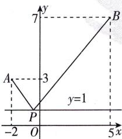

5. 台球运动中反弹球技法是常见的技巧,其中无旋转反弹球是最简单的技法,主球撞击目标球后,目标球撞击台边之后按照光线反射的方向弹出,想

要让目标球沿着理想的方向反弹,就要事先根据需要确认台边的撞击点,同时做到用力适当,方向精确,这样才能通过反弹将目标球成功击入袋中.如图,现有一目标球从点A(-2,3)无旋转射入,经过直线y=1(桌边)上的点P反弹后,经过点B(5,7),则点P的坐标为()

A. $\left(\frac{1}{4}, 1\right)$ B. $\left(-\frac{1}{4}, 1\right)$ C. $\left(\frac{1}{3}, 1\right)$ D. $\left(-\frac{1}{3}, 1\right)$

